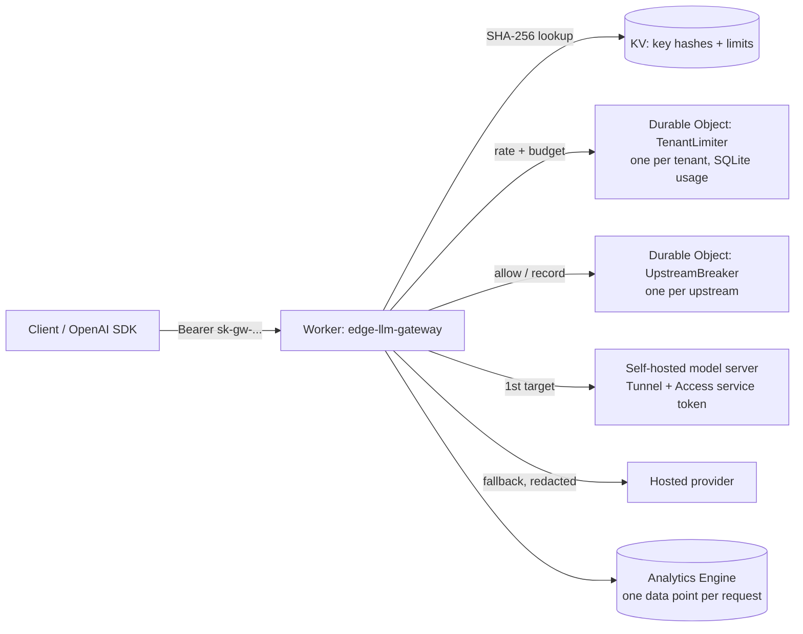

# edge-llm-gateway

An OpenAI-compatible LLM gateway that runs on Cloudflare Workers. Teams call
one endpoint with their own API key; the gateway enforces per-tenant rate
limits and monthly token budgets, routes each model alias to an ordered list
of upstreams (self-hosted vLLM/Ollama behind a Cloudflare Tunnel, or a hosted
provider), falls back when an upstream fails, and records usage per tenant.

Any OpenAI SDK works unchanged:

```python
from openai import OpenAI
client = OpenAI(base_url="https://llm.example.com/v1", api_key="sk-gw-...")
client.chat.completions.create(model="chat-small", messages=[{"role": "user", "content": "hi"}])
```

## Architecture



Request path for `POST /v1/chat/completions`:

1. **Authenticate**: the bearer key is hashed and looked up in KV. Keys are
   never stored in plain text; each maps to a tenant, an allow-list of model
   aliases, a requests-per-minute limit and a monthly token budget.
2. **Validate**: size limit, required fields, `max_tokens` cap. Unknown fields
   pass through, so new OpenAI parameters work without a gateway release.
3. **Budget and rate limit**: one Durable Object per tenant, so limits are
   exact across all Cloudflare locations and shared by every key of a team.
4. **Route**: the alias resolves to an ordered list of `(upstream, model)`
   targets. 408/429/5xx and timeouts move on to the next target; other 4xx
   are returned as-is. Upstreams whose circuit breaker is open are skipped.
5. **Redact** (per upstream): e-mail addresses, Luhn-valid card numbers and
   valid IBANs are replaced before a prompt goes to an upstream marked
   `redact: true`.
6. **Stream or return**: SSE streams pass through event by event while the
   gateway reads the usage chunk; non-streaming responses are read for usage.
   Tokens are charged to the tenant after the response is sent.
7. **Record**: one structured log line and one Analytics Engine data point,
   with metadata only, never prompt or completion text.

## Response headers

| Header | Meaning |
| --- | --- |
| `x-request-id` | Cloudflare ray ID, also sent to the upstream |
| `x-gateway-upstream` | Upstream that produced the response |
| `x-gateway-attempts` | e.g. `primary=503,backup=200` or `primary=circuit_open,backup=200` |
| `x-ratelimit-limit-requests` / `x-ratelimit-remaining-requests` / `retry-after` | Same names OpenAI uses |
| `x-gateway-tokens-remaining-month` | Tenant budget left before this request |
| `x-gateway-redactions` | Number of items redacted, when any |

Errors use the OpenAI error shape (`{"error": {"type", "message", "code"}}`),
including `rate_limit_error` and `insufficient_quota` on 429.

## Configuration

Routing lives in the `GATEWAY_CONFIG` var in [wrangler.jsonc](wrangler.jsonc):
upstreams (base URL, auth, timeout, breaker policy, redaction) and model
aliases (ordered targets). Credentials are never in config, only the names of
Worker secrets. See [docs/configuration.md](docs/configuration.md).

Create a client key (prints the key once and the command that stores its hash):

```sh
node scripts/new-key.mjs --tenant search-team --name ci --models chat-small --rpm 60 --budget 2000000
```

## Deploy

```sh
cd terraform && terraform apply          # KV namespace, custom domain, Access for self-hosted upstreams
# put the KV namespace id from the output into wrangler.jsonc
npx wrangler secret put OPENAI_API_KEY
npx wrangler secret put ACCESS_CLIENT_ID      # from terraform output
npx wrangler secret put ACCESS_CLIENT_SECRET  # terraform output -raw access_client_secret
npx wrangler deploy
```

## Development

```sh
nvm use        # Node 24
npm ci
npm run check  # typecheck, tests in workerd, bundle dry-run
cd terraform && terraform test
```

Tests run inside workerd (the Workers runtime) through
`@cloudflare/vitest-plugin`. Upstreams are a fake OpenAI-compatible server on
the Node side ([test/fake-upstream.ts](test/fake-upstream.ts)) that every
outbound `fetch` is routed to, so timeouts, fallback, streaming and redaction
are tested through the real request path. The fake can fail with any status,
answer slowly, and stream SSE with or without a usage chunk.

## What is and is not verified

Verified in CI, without a Cloudflare account:

- 60+ tests in workerd: auth, validation, model allow-lists, rate limits and
  budgets in real Durable Objects with SQLite storage, fallback on each
  retryable status and on timeout, the circuit breaker opening, skipping and
  probing, SSE passthrough and usage metering (including events split across
  network chunks and CRLF), redaction, telemetry columns.
- `wrangler deploy --dry-run`: the Worker bundles with all bindings.
- Terraform: `validate`, `tflint`, and `terraform test` against the real
  Cloudflare provider schema with a mocked API.

Not verified:

- A deploy to a real account, real latency, and behaviour against real
  providers (their streaming quirks beyond the OpenAI format).
- Analytics Engine queries in [docs/analytics.md](docs/analytics.md) are
  written against the documented SQL API but not run.

## Docs

- [docs/adr](docs/adr): why Workers, why limits in Durable Objects, fallback rules, what redaction is and is not
- [docs/runbooks](docs/runbooks): upstream outage, tenant out of budget, leaked client key, service token rotation
- [docs/analytics.md](docs/analytics.md): per-tenant usage and error queries
